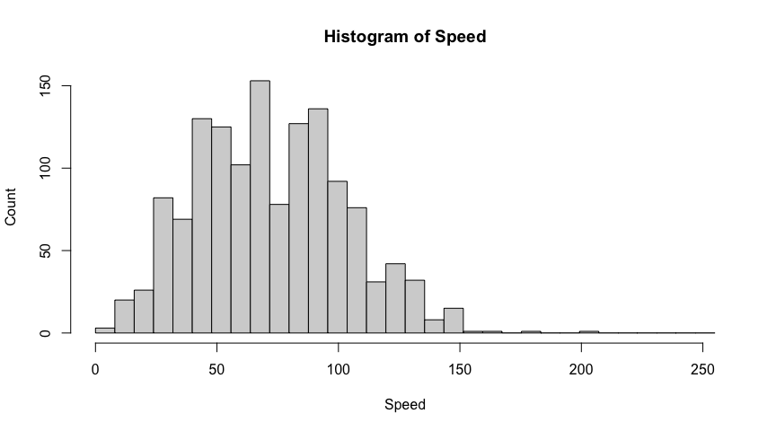
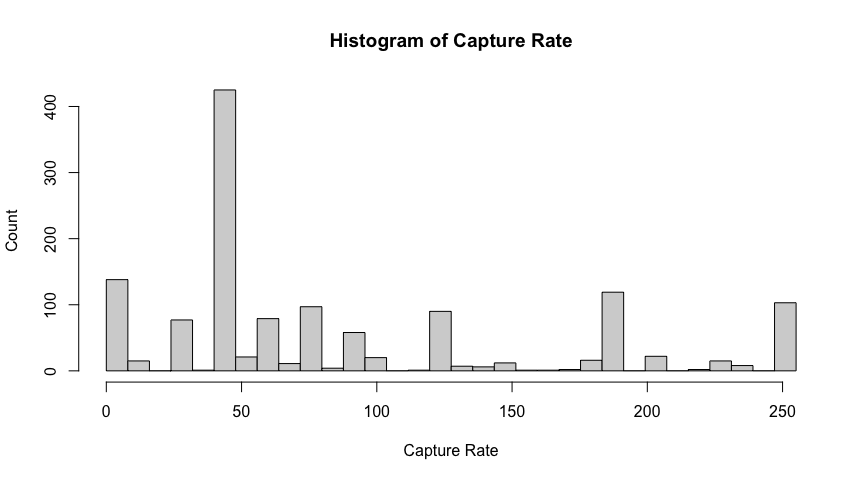
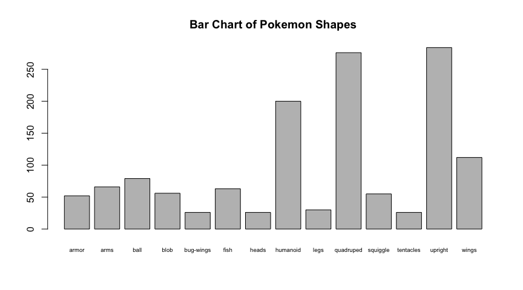
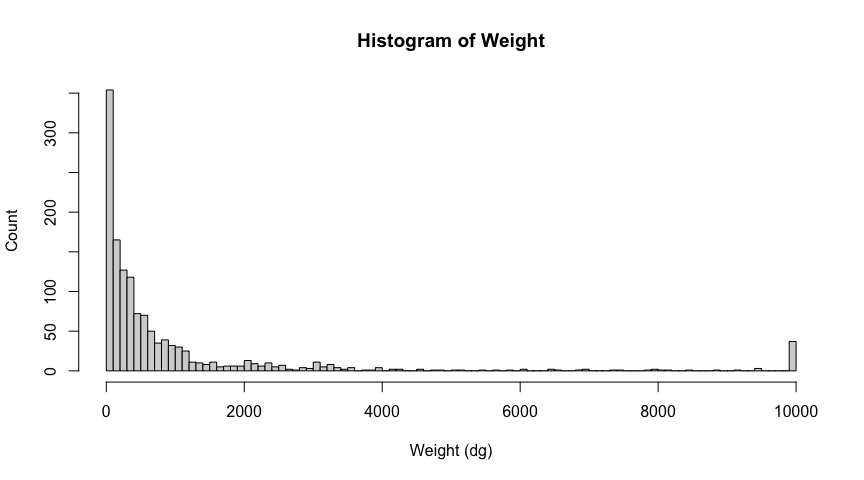
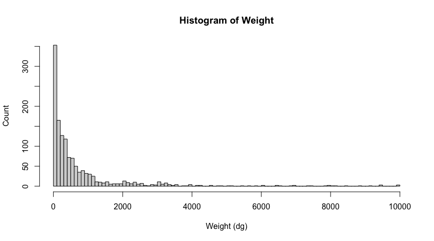
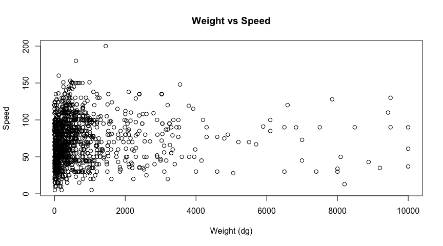
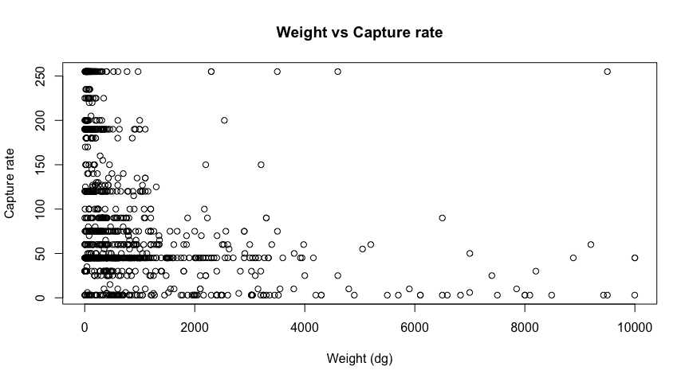
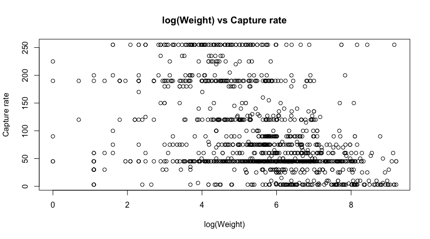
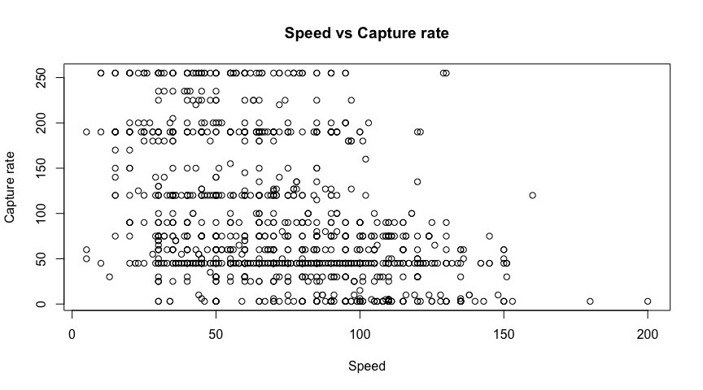

I am choosing a Pokemon dataset I found on Kaggle (
<https://www.kaggle.com/datasets/shreyashautomation/pokemon-stats-dataset>
). Originally from PokeAPI created by Paul Hallett
(<https://pokeapi.co/>), the data was taken back in August. The data
contains information regarding the Pokemon’s attributes like weight,
height, and game statistics. It doesn’t contain gender information nor
how different Pokemon relate to each other. I am an expert because I
have been playing Pokemon since I was a kid and know a lot about the
inner workings of the games. If I need more data I can get more from
PokeAPI.

Questions: Whether Pokemon differ by what generation they were made in,
for example their height, weight, speed? How things differ by what type
the Pokemon is, for example what battle stat does it have as its
highest? Does shape indicate how difficult it is to capture, for example
are fish and bugs easier to capture?

Example Columns: “weight\_hg” is the Pokemon’s weight measured in dg
(yes the column name is incorrect I checked). “capture\_rate” measures
how hard a Pokemon is to capture. The measure goes from 0 to 255. The
lower the number the harder to capture. “speed” measures how fast a
Pokemon is to act in battle. Higher numbers means they act faster.
“shape” is a category that labels the body plan of that Pokemon, for
example quadruped, fish, snake. “type\_1” and “type\_2” are categories
of 16 elements the pokemon can fall into. Each Pokemon has either two
non-overlapping types or only one type, if there is only one then
“type\_2” is null.

    library(readr)
    pokemon <- read_csv("pokemon_complete_stats.csv")

    ## Rows: 1351 Columns: 20
    ## ── Column specification ────────────────────────────────────────────────────────
    ## Delimiter: ","
    ## chr  (7): name, type_1, type_2, abilities, generation, color, shape
    ## dbl (11): id, height_dm, weight_hg, base_experience, hp, attack, defense, sp...
    ## lgl  (2): is_legendary, is_mythical
    ## 
    ## ℹ Use `spec()` to retrieve the full column specification for this data.
    ## ℹ Specify the column types or set `show_col_types = FALSE` to quiet this message.

    hist(pokemon$speed, breaks = seq(0, 255, length.out = 33),
         main="Histogram of Speed", xlab="Speed", ylab="Count")

This is the chart for speed. The higher the speed the faster pokemon
move in battle.  
The Mean is 72.  
The Median is 70.  
The data has a very slight rightward skew, but is mostly normal.  
The best measure of center is the mean, but they are nearly the same.

    hist(pokemon$capture_rate, breaks = seq(0, 255, length.out = 33),
         main="Histogram of Capture Rate", xlab="Capture Rate", ylab="Count")

This is the chart for capture rate. The higher the capture rate the
harder a Pokemon is the catch. The Mean is 89.11029.  
The Median is 55.  
The data is spaced out with clusters around common values. There are a
large amount of Pokemon with a value of 45. The data itself is skewed
right thanks to the large number of 45s.  
The best measure of center is the mean due to the spread out nature of
the data and the large number of 45s.

    table(pokemon$shape) |> barplot(main="Bar Chart of Pokemon Shapes", 
    cex.names = 0.6)

This is the chart for shapes. Each Pokemon has a given shape category.  
The mode is the “Upright” shape.  
Quadruped and Upright are nearly the same, with only humanoid coming
near these two.

    hist(pokemon$weight_hg, breaks = seq(0, 10000, length.out = 101),
         main="Histogram of Weight", xlab="Weight (dg)", ylab="Count")

This is the chart for weight.  
The Mean is 991.06.  
The Median is 326.  
The data clearly has outliers. There is a large number of Pokemon with
the 10000 dg weight (and one 0 placeholder). These correspond with the
“dynamax” Pokemon, where a Pokemon becomes huge and unmeasurably heavy.
These should be discarded because every Pokemon has a dynamax form with
this same unlisted weight. Also the only dynamax Pokemon that show up in
this dataset are the ones who look different when in dynamax form, as
opposed to just using their regular appearance scaled up. If we remove
these the data becomes clearer.

    pokemonNoOutliers = subset(subset(pokemon, weight_hg!=10000), weight_hg!=0)
    hist(pokemonNoOutliers$weight_hg, breaks = seq(0, 10000, length.out = 101),
         main="Histogram of Weight", xlab="Weight (dg)", ylab="Count")

The new mean is 759.0593.  
The new median is 315.  
The data is skewed right and mostly goes down as weight increases with
some small bumps around 2000 and 3000.  
The best measure of center is the median due to the large skewing.

Now I will do a correlation between the weight and speed.

    plot(pokemonNoOutliers$weight_hg, pokemonNoOutliers$speed,
         main="Weight vs Speed", xlab="Weight (dg)", ylab="Speed")

The correlation comes out to 0.05529087.  
They are not correlated much at all. This is a little suprising, I
expected there to be a decent number of heavy and slow Pokemon like the
rock or steel Pokemon.

Next I will look at the relationship between weight and capture rate:

    plot(pokemonNoOutliers$weight_hg, pokemonNoOutliers$capture_rate,
         main="Weight vs Capture rate",
         xlab="Weight (dg)", ylab="Capture rate")

The correlation is -0.2975353.  
The correlation is weak, but is there.  
Here is the plot with weight logged:

    plot(log(pokemonNoOutliers$weight_hg), pokemonNoOutliers$capture_rate,
         main="log(Weight) vs Capture rate",
         xlab="log(Weight)", ylab="Capture rate")

With the log of weight you get a correlation of -0.4222861.  
The higher the weight the lower the capture rate.  
The makes sense since the bigger and heavier Pokemon tend to be the
stronger versions of their lighter counterparts and thus harder to
catch. For example a Pokemon will evolve and that later evolution will
often be heavier and be harder to capture.

Next I will look at speed and capture rate:

    plot(pokemonNoOutliers$speed, pokemonNoOutliers$capture_rate,
         main="Speed vs Capture rate",
         xlab="Speed", ylab="Capture rate")

The correlation is -0.399774.  
Speed is more strongly correlated to capture rate than linear weight.
This makes sense because speed is a more direct measure of a Pokemon’s
strength.
